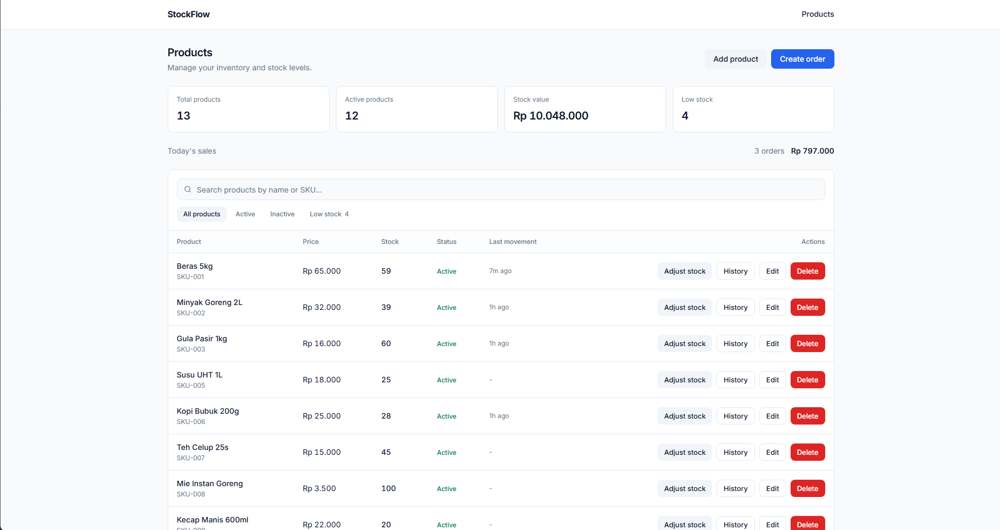

# StockFlow - Inventory & Sales

## Clone
```bash
git clone https://github.com/dimassfeb-09/stockflow
cd stockflow
```

## Run
```bash
docker compose up --build
```

Database migrations and seed data are applied automatically on first run.

## Open
- Frontend: http://localhost:5173
- Backend API: http://localhost:8080
- Postgres: localhost:5434

## Tests

Backend:
```bash
cd backend
go test ./...
go test -race -tags=integration ./...
```

Frontend:
```bash
cd frontend
npm install
npm test
npm run build
```

## Screenshots


## Port conflict
If ports are in use, change only the host side in `docker-compose.yml`, e.g. `8081:8080`.
